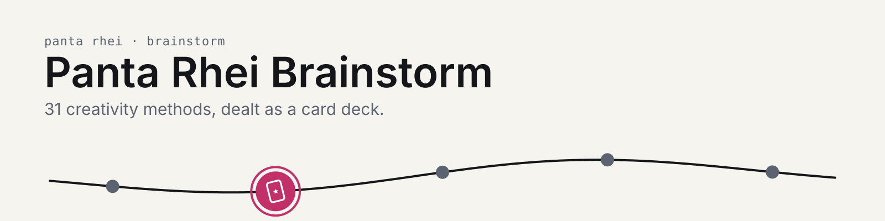
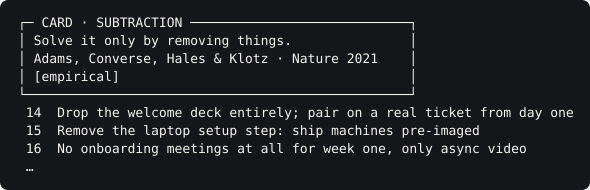

<p align="center"></p>

# Panta Rhei Brainstorm

A brainstorming and idea-generation skill for Claude, Claude Code and Hermes: 31 creativity methods dealt as cards.

<p align="center">
  <a href="#install"></a>
  
  
  
</p>

## What it does

Ask an AI for ideas and you get ten sensible ones, judged before they were finished. Panta Rhei Brainstorm runs a real ideation session instead: it deals method cards from the creativity literature,
produces a burst of unjudged ideas under each, and only scores them once the wall is full. You get
forty ideas you would not have had, clustered into themes, and a shortlist of three.

## Try it

Say any of these after installing:

> Brainstorm names for a neighbourhood bakery
> Give me creative ways to onboard new engineers without more meetings
> Go wild: how could a public library make money?

## How it works: The Deck

Every method is a card. Each round, the skill draws the cards that fit your challenge, plus one
wildcard you would never have picked.

<p align="center"></p>

<p align="center"></p>

1. **Draw:** two cards per round, chosen for the type of challenge, plus a wildcard.
2. **Burst:** 8–15 ideas per card, numbered, no "but".
3. **Wall:** every idea clustered into themes; the outliers flagged, because they are often the best.
4. **Shortlist:** only now, a quick score on novelty, feasibility and impact. Top three, plus the best wildcard.

Three modes: **quick** (one card, ten ideas), **session** (default), **wild** (wildcards only).
Running it with a team? Say so and you get a facilitator script with timings, silent brainwriting
first.

## Install

**Claude Code**
```
/plugin marketplace add fairyanna85/pantarhei-brainstorm
/plugin install pantarhei-brainstorm@pantarhei-brainstorm
```
Or the whole family: `/plugin marketplace add fairyanna85/pantarhei`.

**Hermes Agent**
```
hermes skills install https://github.com/fairyanna85/pantarhei-brainstorm
```

**Claude apps (web, desktop, mobile)**
1. Download [`pantarhei-brainstorm.zip`](https://github.com/fairyanna85/pantarhei-brainstorm/releases/latest/download/pantarhei-brainstorm.zip).
2. Go to **Customize > Skills**, click **+**, then **+ Create skill**, then **Upload a skill**, and choose the ZIP.
3. Turn the skill on. Code execution and file creation must be enabled (Settings > Capabilities).

**Any Agent Skills client** (Codex, Cursor and others): copy `skills/pantarhei-brainstorm/` into your
client's skills folder.

## What's inside

31 methods of its own, plus 0 shared with sister skills and 16 audit models from the shared library. Every method carries an evidence class and a named failure mode.

### Transform what exists

- **SCAMPER** — Seven transformations applied to something that already exists: substitute, combine, adapt, modify, put to another use, eliminate, reverse.
- **Inside-the-box templates** — Five moves applied to the existing components of a product or process: subtract an essential part, divide it, multiply a part with a change, give one…
- **Subtraction** — People default to adding when they improve something.
- **Attribute listing** — Break the thing into its attributes (material, shape, price, user, timing) and change one attribute at a time.
- **Eliminate-Reduce-Raise-Create grid** — Four questions on the factors an industry competes on: which to eliminate, which to reduce below standard, which to raise above standard, which to…

### Explore the space

- **Morphological box** — List the independent dimensions of a solution, list options on each, then combine one option per dimension.
- **Lotus blossom** — A 3x3 grid with the challenge at the centre and eight themes around it; each theme becomes the centre of its own grid of eight ideas.
- **Mind map** — Put the challenge at the centre and branch outward by association, one word per branch.
- **Crazy 8s** — Eight distinct sketches or variations in eight minutes.
- **Adjacent possible** — The ideas reachable now are one step from what already exists.

### Break the frame

- **Assumption reversal** — List the assumptions a domain takes for granted, flip each one into its opposite, then ask how the reversed version could work.
- **Provocation (PO)** — State something deliberately false or impossible, then use it as a stepping stone: extract a principle from it, move to a workable idea.
- **Random entry** — Pick an unrelated word or object at random and force connections between it and the problem.
- **Worst possible idea** — Generate the worst ideas on purpose, then invert each one or find the grain of value inside it.
- **Oblique prompts** — A deck of short, indirect instructions drawn at random when stuck.
- **Ten times, not ten percent** — Aim for a tenfold improvement instead of a marginal one.

### Borrow from elsewhere

- **Who else solved this** — Abstract the problem to its structure, then search other fields for a solved problem with the same structure and transfer the solution.
- **Ask nature** — Restate the function needed (adhere, cool, filter, signal) and look for organisms that perform it.
- **Bisociation** — Creative insight as the collision of two frames of reference that do not normally meet.
- **Make it strange** — Use direct, personal and fantastic analogies to make the familiar strange: become the object, describe it as nature would solve it, imagine it…
- **Intersection** — Ideas cluster where fields, cultures and disciplines intersect.
- **Borrowed eyes** — Generate ideas as a specific other person or role would: a competitor, a child, a regulator, a famous designer, your harshest customer.

### Dissolve trade-offs

- **Resolve the contradiction** — State the problem as a contradiction: improving X worsens Y.
- **Hold both opposites** — Conceive two opposite or contradictory ideas as true at the same time and build from the tension rather than choosing one.
- **Add a constraint** — Impose an arbitrary limit (half the budget, no screens, one day, only existing staff) and solve within it.

### Run the session

- **Diverge, then converge** — Generate first with judgment switched off, evaluate afterwards in a separate pass.
- **Idea quota** — Set a number before starting and do not stop short of it.
- **Brainwriting** — Each person writes ideas silently, then passes them on for others to build on.
- **Yes, and** — Accept the previous idea and build on it before adding a new one.
- **Dreamer, Realist, Critic** — Three separate passes with three separate roles: the Dreamer imagines without limits, the Realist plans how it would actually work, the Critic finds…
- **Incubate** — Load the problem fully, then step away to unrelated activity before returning.

### Audit models (16)

- **First Principles Thinking** — Strip a problem down to what is known to be true, discarding convention and analogy, then reason upward from there.
- **Thought Experiment** — Run the scenario in your head: change one variable, imagine the outcome, follow it through.
- **Inversion** — Approach the problem backwards: ask what would make it fail, or what you want to avoid, then steer away from that.
- **Alloying** — Combining ingredients in the right proportions can produce properties none of them has alone.
- **Replication** — Copying a proven approach is often faster and safer than inventing one.
- **Margin of Safety** — Build in more capacity than the expected load requires, to absorb errors and surprises.
- **Emergence** — Interacting parts can produce behaviour that none of them has alone.
- **Equivalence** — Different inputs or routes can lead to the same result.
- **Trade-offs** — Choosing one option gives up the others.
- **Audience** — Every message is received by a particular audience with its own knowledge and expectations.
- **Contrast** — We judge things relative to what is next to them.
- **Framing** — How a choice is presented changes how people respond to it, even when the facts are the same.
- **Melody** — A melody is a sequence of notes heard as one shape.
- **Plot** — A plot is a chain of events linked by cause, usually driven by conflict toward a resolution.
- **Asymmetric Warfare** — A weaker party can beat a stronger one by refusing to fight on the stronger party's terms.
- **Curiosity Instinct** — People are driven to explore and understand, beyond immediate need.

## How honest is it?

Every card shows where the method comes from and how well it is supported: `empirical` (studied,
e.g. subtraction, brainwriting, incubation), `heuristic` (practitioner methods that work as prompts),
or `analogical` (borrowed from other fields: idea generators only). The cards rate the methods, not
your ideas: no idea is evidence of anything until it has been tested.

## The Panta Rhei pack (optional)

Each module works on its own. The pack installs all five plus Panta Rhei, the hub that runs them
end to end.

| | Module | For |
|---|---|---|
| 🔵 | [Panta Rhei Reframe](https://github.com/fairyanna85/pantarhei-reframe) | Working out what the real problem is |
| 🟣 | [Panta Rhei Brainstorm](https://github.com/fairyanna85/pantarhei-brainstorm) | Brainstorming and idea generation |
| 🟢 | [Panta Rhei Solve](https://github.com/fairyanna85/pantarhei-solve) | Structuring and diagnosing problems |
| 🔴 | [Panta Rhei Challenge](https://github.com/fairyanna85/pantarhei-challenge) | Red-teaming ideas and claims |
| 🟡 | [Panta Rhei Decide](https://github.com/fairyanna85/pantarhei-decide) | Making the call |
| ⚫ | [Panta Rhei](https://github.com/fairyanna85/pantarhei) | The pack: all five, end to end |

Panta Rhei Brainstorm is complete on its own. Installed alongside its siblings, its shortlist flows straight into
Panta Rhei Challenge to be attacked or Panta Rhei Decide to be chosen.

## Credits and license

Methods are credited to their originators on every card and in `catalog.json`; all descriptions are
our own wording. The oblique-prompt deck is original, inspired by Brian Eno and Peter Schmidt.
Code: MIT. Method text: CC BY 4.0. Propose a method: see [CONTRIBUTING.md](CONTRIBUTING.md).
