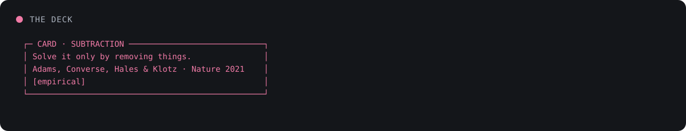

<p align="center"></p>

# Panta Rhei Brainstorm

A brainstorming and idea-generation skill for Claude, Claude Code and Hermes: 31 creativity methods dealt as cards.

<p align="center">
  <a href="#install"></a>
  
  
  
</p>

## What it does

Ask an AI for ideas and you get ten sensible ones, judged before they were finished. Panta Rhei Brainstorm runs a real ideation session instead: it deals method cards from the creativity literature,
produces a burst of unjudged ideas under each, and only scores them once the wall is full. You get
forty ideas you would not have had, clustered into themes, and a shortlist of three.

## Try it

Say any of these after installing:

> Brainstorm names for a neighbourhood bakery
> Give me creative ways to onboard new engineers without more meetings
> Go wild: how could a public library make money?

## How it works: The Deck

Every method is a card. Each round, the skill draws the cards that fit your challenge, plus one
wildcard you would never have picked.

<p align="center"></p>

```
┌─ CARD · SUBTRACTION ────────────────────────────┐
│ Solve it only by removing things.               │
│ Adams, Converse, Hales & Klotz · Nature 2021    │
│ [empirical]                                     │
└─────────────────────────────────────────────────┘
 14  Drop the welcome deck entirely; pair on a real ticket from day one
 15  Remove the laptop setup step: ship machines pre-imaged
 16  No onboarding meetings at all for week one, only async video
 …
```

1. **Draw:** two cards per round, chosen for the type of challenge, plus a wildcard.
2. **Burst:** 8–15 ideas per card, numbered, no "but".
3. **Wall:** every idea clustered into themes; the outliers flagged, because they are often the best.
4. **Shortlist:** only now, a quick score on novelty, feasibility and impact. Top three, plus the best wildcard.

Three modes: **quick** (one card, ten ideas), **session** (default), **wild** (wildcards only).
Running it with a team? Say so and you get a facilitator script with timings, silent brainwriting
first.

## Install

**Claude Code**
```
/plugin marketplace add fairyanna85/pantarhei-brainstorm
/plugin install pantarhei-brainstorm@pantarhei-brainstorm
```
Or the whole family: `/plugin marketplace add fairyanna85/pantarhei`.

**Hermes Agent**
```
hermes skills install https://github.com/fairyanna85/pantarhei-brainstorm
```

**Claude apps (web, desktop, mobile)**
1. Download [`pantarhei-brainstorm.zip`](https://github.com/fairyanna85/pantarhei-brainstorm/releases/latest/download/pantarhei-brainstorm.zip).
2. Go to **Customize > Skills**, click **+**, then **+ Create skill**, then **Upload a skill**, and choose the ZIP.
3. Turn the skill on. Code execution and file creation must be enabled (Settings > Capabilities).

**Any Agent Skills client** (Codex, Cursor and others): copy `skills/pantarhei-brainstorm/` into your
client's skills folder.

## What's inside

| Group | Methods |
|---|---|
| **Transform what exists** | SCAMPER · Inside-the-box templates · Subtraction · Attribute listing · Eliminate-Reduce-Raise-Create grid |
| **Explore the space** | Morphological box · Lotus blossom · Mind map · Crazy 8s · Adjacent possible |
| **Break the frame** | Assumption reversal · Provocation · Random entry · Worst possible idea · Oblique prompts · Ten times, not ten percent |
| **Borrow from elsewhere** | Who else solved this · Ask nature · Bisociation · Make it strange · Intersection · Borrowed eyes |
| **Dissolve trade-offs** | Resolve the contradiction (TRIZ) · Hold both opposites · Add a constraint |
| **Run the session** | Diverge, then converge · Idea quota · Brainwriting · Yes, and · Dreamer, Realist, Critic · Incubate |

## How honest is it?

Every card shows where the method comes from and how well it is supported: `empirical` (studied,
e.g. subtraction, brainwriting, incubation), `heuristic` (practitioner methods that work as prompts),
or `analogical` (borrowed from other fields: idea generators only). The cards rate the methods, not
your ideas: no idea is evidence of anything until it has been tested.

## The Panta Rhei pack (optional)

Each module works on its own. The pack installs all five plus Panta Rhei, the hub that runs them
end to end.

| | Module | For |
|---|---|---|
| 🔵 | [Panta Rhei Reframe](https://github.com/fairyanna85/pantarhei-reframe) | Working out what the real problem is |
| 🟣 | [Panta Rhei Brainstorm](https://github.com/fairyanna85/pantarhei-brainstorm) | Brainstorming and idea generation |
| 🟢 | [Panta Rhei Solve](https://github.com/fairyanna85/pantarhei-solve) | Structuring and diagnosing problems |
| 🔴 | [Panta Rhei Challenge](https://github.com/fairyanna85/pantarhei-challenge) | Red-teaming ideas and claims |
| 🟡 | [Panta Rhei Decide](https://github.com/fairyanna85/pantarhei-decide) | Making the call |
| ⚫ | [Panta Rhei](https://github.com/fairyanna85/pantarhei) | The pack: all five, end to end |

Panta Rhei Brainstorm is complete on its own. Installed alongside its siblings, its shortlist flows straight into
Panta Rhei Challenge to be attacked or Panta Rhei Decide to be chosen.

## Credits and license

Methods are credited to their originators on every card and in `catalog.json`; all descriptions are
our own wording. The oblique-prompt deck is original, inspired by Brian Eno and Peter Schmidt.
Code: MIT. Method text: CC BY 4.0. Propose a method: see [CONTRIBUTING.md](CONTRIBUTING.md).
